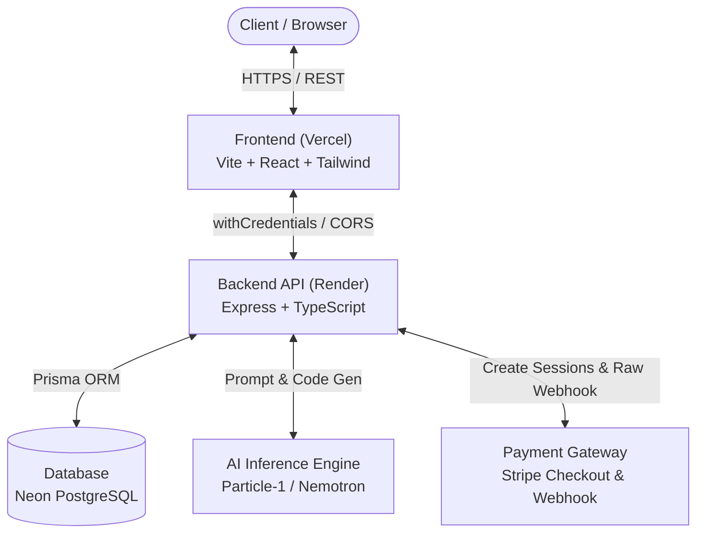

# 🌐 AI Web Builder — Production-Ready AI Site Generator

[](https://ai-web-builder-two.vercel.app/)
[](https://ai-web-builder-server-ej5k.onrender.com/)
[](https://neon.tech)
[](https://www.typescriptlang.org/)

An enterprise-grade, full-stack platform that transforms natural language prompts into fully functional, responsive, single-page websites with instant live previews, multi-device viewports, AI revision history, and Stripe-powered credit management.

---

## 🔗 Live Deployments

| Tier | Platform | URL |
| :--- | :--- | :--- |
| **Frontend Application** | Vercel Edge | [https://ai-web-builder-two.vercel.app](https://ai-web-builder-two.vercel.app) |
| **Backend API Gateway** | Render Web Service | [https://ai-web-builder-server-ej5k.onrender.com](https://ai-web-builder-server-ej5k.onrender.com) |
| **PostgreSQL Database** | Neon Serverless | AWS Southeast Asia Region |

---

## ⚡ Key Capabilities

- **Instant AI Site Generation**: Generates complete, modern single-page HTML applications styled with Tailwind CSS in seconds.
- **Smart Prompt Enhancement**: Uses multi-stage prompt engineering to enrich basic requests with UX specifications, typography, and responsive layouts.
- **Dual-Model Fallback Pipeline**: High-availability AI generation with primary and fallback models to eliminate downtime.
- **Live Device Viewport Preview**: Test generated websites instantly across Desktop, Tablet, and Mobile device frames.
- **Granular AI Revisions & Versioning**: Iteratively update your website with natural language; rollback to any previous version at any time.
- **Stripe Checkout & Webhooks**: Automated credit purchasing with cryptographic signature verification and idempotent fulfillment.
- **One-Click Publishing & Community**: Publish projects with unique public URLs and explore websites generated by other creators.
- **Fullstack Cross-Domain Auth**: Session management powered by Better Auth with secure `SameSite=None; Partitioned` cross-site cookie protocol.

---

## 🏗️ System Architecture



---

## 💻 Tech Stack

### Frontend (`client/`)
- **Core**: React 19, TypeScript, Vite
- **Styling**: Tailwind CSS v4, Lucide Icons
- **State & Routing**: React Router v7
- **Authentication UI**: `@daveyplate/better-auth-ui`
- **HTTP Client**: Axios with credentials inclusion
- **Notifications**: Sonner toasts

### Backend (`server/`)
- **Runtime**: Node.js v20+, Express v5
- **Language**: TypeScript (`tsx` execution engine)
- **Database & ORM**: PostgreSQL via Prisma ORM v7
- **Authentication**: Better Auth with Prisma adapter
- **Payments**: Stripe API SDK (`stripe@^23.0`)
- **AI Integration**: OpenAI SDK connected to OpenRouter API

---

## 📂 Repository Structure

```text
AI-Web-Builder/
├── client/                     # Frontend Vite + React application
│   ├── src/
│   │   ├── components/         # Navbar, EditorPanel, ProjectPreview, etc.
│   │   ├── pages/              # Home, Projects, Pricing, Community, Preview
│   │   ├── configs/            # Axios instance and base config
│   │   └── lib/                # Auth client and utils
│   ├── vercel.json             # SPA routing rewrite rule
│   └── package.json
├── server/                     # Backend Express REST API
│   ├── configs/                # OpenRouter / OpenAI client config
│   ├── controllers/            # Project, User, and Webhook business logic
│   ├── lib/                    # Better Auth and Prisma client initializers
│   ├── middlewares/            # Protect auth session validator
│   ├── prisma/                 # Schema definitions and migrations
│   ├── routes/                 # Express route handlers
│   └── server.ts               # Primary server entrypoint
├── render.yaml                 # Infrastructure-as-code for Render
└── README.md
```

---

## ⚙️ Local Development Protocol

### Prerequisites
- **Node.js**: `v20.x` or higher
- **Package Manager**: `npm` (v10+)
- **PostgreSQL**: Neon DB connection string or local Postgres instance
- **Stripe Account**: Free developer test keys
- **OpenRouter Account**: API key for inference

---

### Step 1: Clone Repository
```bash
git clone https://github.com/vishal-mishra-10/AI-Web-Builder.git
cd AI-Web-Builder
```

---

### Step 2: Configure Server Environment

Navigate to the `server/` directory and configure `.env`:

```bash
cd server
cp .env.example .env # or create .env
```

Fill in your secrets:

```env
# Server Runtime
PORT=3000
NODE_ENV=development
TRUSTED_ORIGINS="http://localhost:5173"

# Database Connection (Neon PostgreSQL)
DATABASE_URL="postgresql://<user>:<password>@<neon-host>/neondb?sslmode=require"

# Better Auth Configuration
BETTER_AUTH_SECRET="your-32-character-secret-key"
BETTER_AUTH_URL="http://localhost:3000"

# AI Inference (OpenRouter API)
AI_API_KEY="sk-or-v1-xxxxxxxxxxxxxxxxxxxx"

# Stripe Test Keys
STRIPE_PUBLISHABLE_KEY="pk_test_xxxxxxxxxxxxxxxxxxxx"
STRIPE_SECRET_KEY="sk_test_xxxxxxxxxxxxxxxxxxxx"
STRIPE_WEBHOOK_SECRET="whsec_xxxxxxxxxxxxxxxxxxxx"
```

Install dependencies and run database migrations:
```bash
npm install
npx prisma generate
npm run server
```
*Backend will boot at `http://localhost:3000`.*

---

### Step 3: Configure Client Environment

In a new terminal window:

```bash
cd client
```

Create a `.env` file:
```env
VITE_BASEURL='http://localhost:3000'
```

Install dependencies and boot Vite dev server:
```bash
npm install
npm run dev
```
*Frontend will boot at `http://localhost:5173`.*

---

### Step 4: Local Stripe Webhook Testing (Optional)

To test Stripe payment events on `localhost`:

```bash
# Install Stripe CLI
brew install stripe/stripe-cli/stripe

# Authenticate
stripe login

# Forward events to your local webhook endpoint
stripe listen --forward-to localhost:3000/api/webhook/stripe
```
*Copy the temporary `whsec_...` secret printed in your terminal into `server/.env`.*

---

## 📡 API Reference

### User & Account Management
| Method | Endpoint | Access | Description |
| :--- | :--- | :--- | :--- |
| `GET` | `/api/user/credits` | Authenticated | Retrieve current user's available credits |
| `POST` | `/api/user/purchase-credits` | Authenticated | Initialize Stripe Checkout session for a plan |
| `GET` | `/api/user/projects` | Authenticated | Fetch list of projects belonging to user |
| `GET` | `/api/user/project/:id` | Authenticated | Fetch single project with conversation & versions |
| `POST` | `/api/user/project` | Authenticated | Generate new website project (-5 credits) |
| `GET` | `/api/user/publish-toggle/:id` | Authenticated | Toggle website between public and private |

### Website Project Operations
| Method | Endpoint | Access | Description |
| :--- | :--- | :--- | :--- |
| `POST` | `/api/project/revision/:id` | Authenticated | Request AI modification to existing site (-5 credits) |
| `PUT` | `/api/project/save/:id` | Authenticated | Save manual code modifications |
| `GET` | `/api/project/rollback/:id/:vId` | Authenticated | Rollback to specific historical version |
| `DELETE` | `/api/project/:id` | Authenticated | Delete project permanently |
| `GET` | `/api/project/published` | Public | Explore all community published projects |
| `GET` | `/api/project/published/:id` | Public | Render standalone public website |

### Stripe Webhook Receiver
| Method | Endpoint | Payload Format | Description |
| :--- | :--- | :--- | :--- |
| `POST` | `/api/webhook/stripe` | `application/octet-stream` (Raw) | Verifies signature & fulfills credit additions |

---

## 🔒 Security & Production Protocols

1. **Raw Body Preserved for Webhooks**: The `/api/webhook` route is mounted **before** `express.json()` using `express.raw()`, ensuring cryptographic signature integrity with `stripe.webhooks.constructEvent()`.
2. **Cross-Origin Cookie Isolation**: Configured with `SameSite=None; Secure; Partitioned` attributes to adhere to modern third-party cookie restrictions (CHIPS protocol).
3. **Strict CORS Whitelisting**: Dynamic origin inspection against `TRUSTED_ORIGINS` prevents unauthorized cross-site scripting.
4. **Prisma Idempotency Guards**: Transaction status validation ensures Stripe webhook retry attempts cannot duplicate credit additions.

---

## 👥 Authors & Contributors

1. **Anurag Choubey**
2. **Shivam Choubey**
3. **Sankalp Tripathi**
4. **Vishal Mishra**
